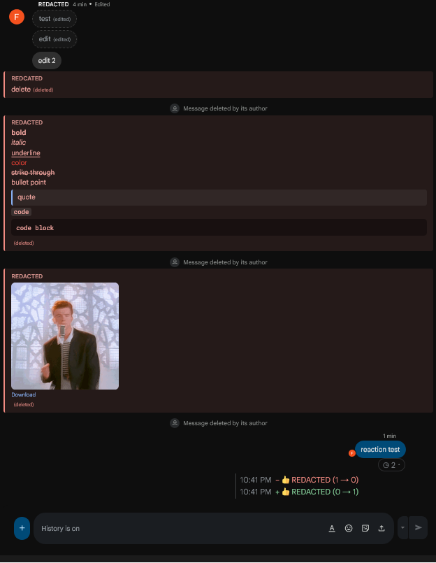
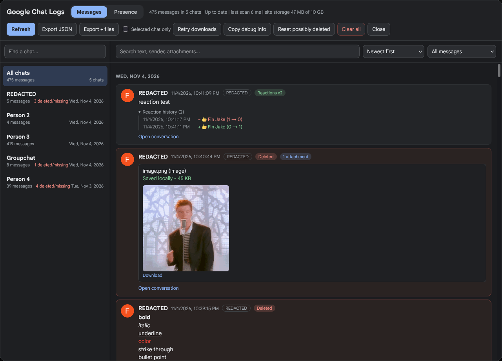
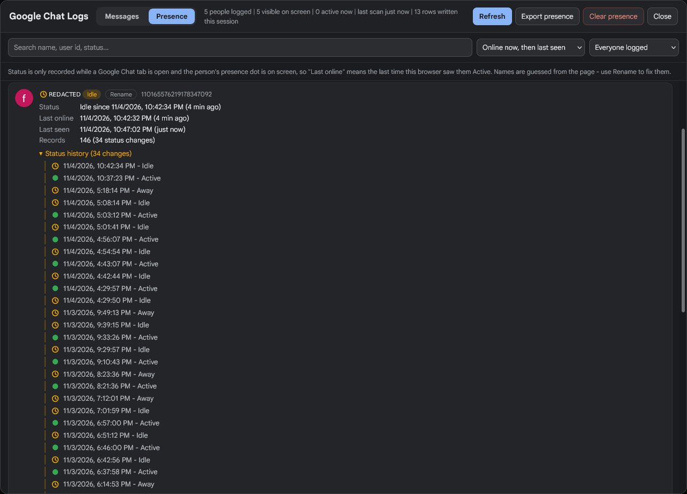

# Google Chat Stalker

> This userscript was completely vibe coded the code probably sucks feel free to submit issues or pull requests

Logs everything in Google Chat locally in your browser.

| Logs | |
|---|---|
| Messages | text, formatting, sender, timestamp |
| Edits | every old version, shown under the message |
| Deletions | deleted messages are kept and flagged |
| Attachments | images, videos, audio, files (up to 50 MB each) |
| Reactions | every add/remove with who and the exact time |
| Presence | active / idle / away changes and last seen |

Also has a built-in viewer with search, filters and JSON export.

## Screenshots
> user-script will show real display names I replaced them with person 1, person 2, etc for privacy reasons

## Install

1. Install a userscript manager
   * Firefox: [Tampermonkey](https://addons.mozilla.org/firefox/addon/tampermonkey/) or [Violentmonkey](https://addons.mozilla.org/firefox/addon/violentmonkey/)
   * Chromium: [Tampermonkey](https://www.tampermonkey.net/) or [Violentmonkey](https://violentmonkey.github.io/)
2. **[Install the userscript](https://github.com/chromecrash/google-chat-stalker/raw/refs/heads/main/google-chat-stalker.user.js)**

## Usage

Click the launcher button the script adds to Google Chat to open the viewer, or run `viewChatLogs()` in the console (F12). It only logs what's loaded so scroll up to load older messages.

Console commands

| Command | |
|---|---|
| `viewChatLogs()` | open the viewer |
| `viewPresence()` | open the presence tab |
| `presenceSummary()` | everyone's current status |
| `lastSeen(id)` | last seen for a user ID |
| `scanChatMessages()` | force a scan |
| `clearChatLogs()` | delete all logs |
| `gcReactionProbe()` | test reading who reacted |
| `gcDebug()` `gcDumpFormat()` `gcDumpAttachments()` | debug dumps |

Reaction names only show in a hover popup so the script briefly opens it after a reaction changes (you may see it flash). Set `REACTION_PROBE` to `false` at the top of the script to turn that off.

## Known issues

> ⚠
> It saves every single message and attachment it sees. This can use a lot of storage and make your browser laggy. Export and clear old logs once in a while. Clearing site data for chat.google.com wipes the log too.

* It uses dom scraping so it may break when google updates Google Chat. If it stops working you might need to update the constants at the top of the script (`MESSAGE_SELECTOR`, `REACTION_SELECTOR` etc.) with the new dom values. Pull requests are welcome.
* Only tested on Firefox, should work on Chromium but I haven't tried.
